# Post-contenido — Unidad 9: Seguridad en Aplicaciones Web

Laboratorio de Programación Web (Séptimo Semestre). Un único proyecto Maven Spring Boot
(`seguridad-web/`, paquete `com.universidad.seguridad`) con dos mecanismos de autenticación
que conviven: **sesión** para las vistas Thymeleaf y **JWT stateless** para la API REST
bajo `/api/**`.

**Estado: Partes 1 y 2 completas.**

## Parte 1: Login con sesión, BCrypt, roles y mitigación activa

`SecurityConfig` define `webFilterChain` (`@Order(2)`) con form-login,
`BCryptPasswordEncoder(12)` y autorización por rol (`HttpSecurity` y `@PreAuthorize`).
CSRF queda activo porque esta cadena depende de cookie de sesión.

### Login y roles
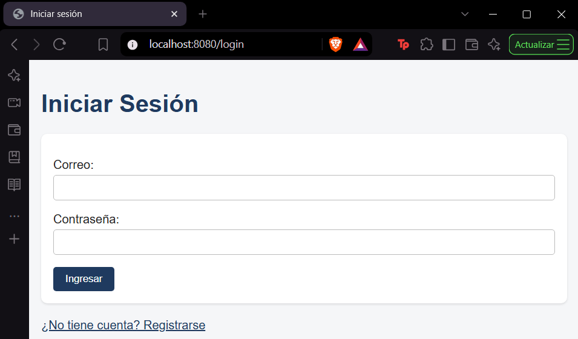
Acceder a `/dashboard` sin sesión redirige a `/login`.

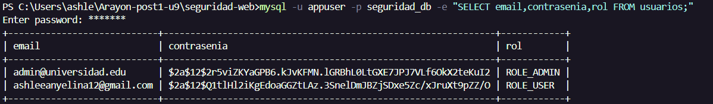
Las contraseñas se guardan como hash (`$2a$12$...`), nunca en texto claro.

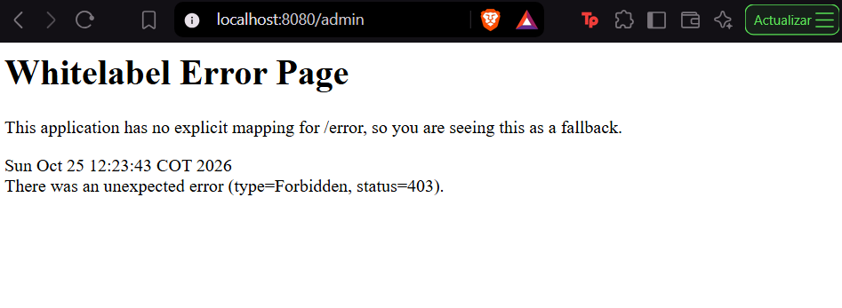
Un USER que entra a `/admin` recibe 403.

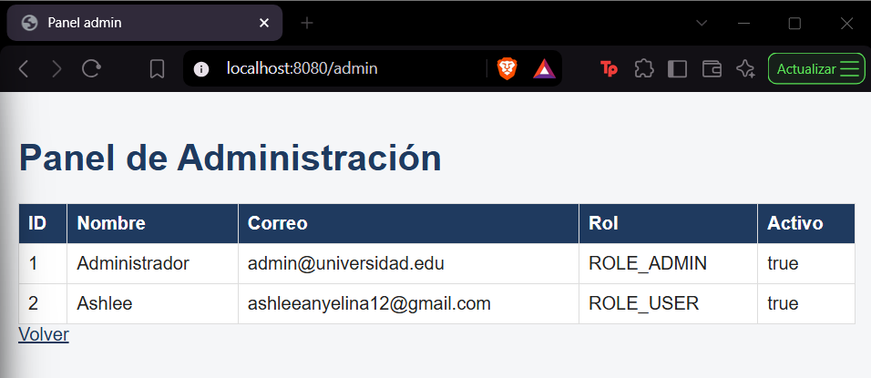
El ADMIN ve la lista de usuarios.

### XSS: `th:text` vs `th:utext`
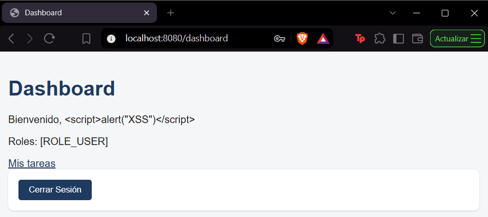
Con `th:text`, el nombre `` se muestra como texto escapado.

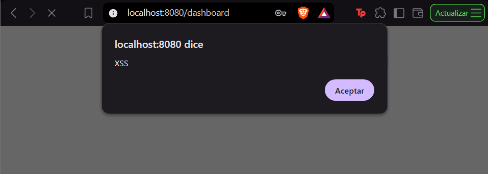
Prueba **temporal** con `th:utext`: el script se ejecuta. Se revirtió con `git restore`;
el repositorio solo contiene la versión segura.

### SQL Injection: `@Query` parametrizado
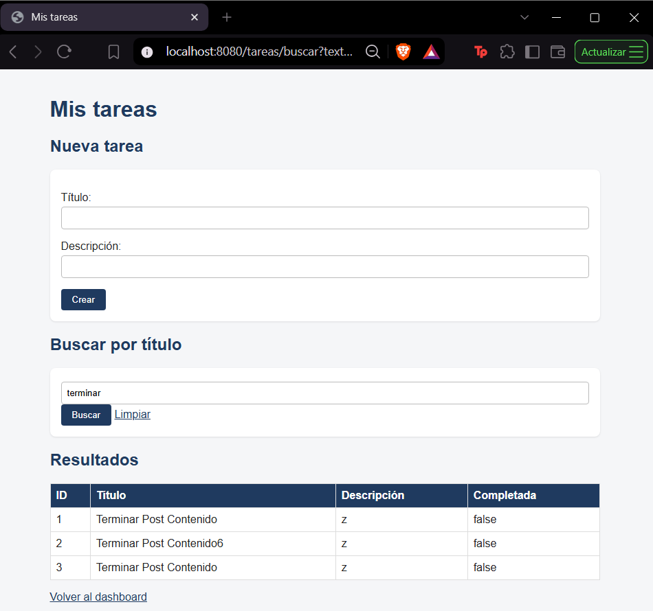
Búsqueda normal por título.

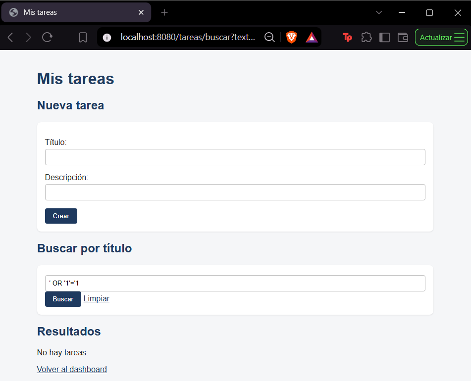
Buscar `' OR '1'='1` devuelve 0 resultados: se trata como texto literal.

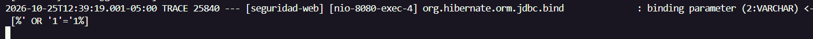
Hibernate envía `like replace(?,...)` con el valor como parámetro enlazado. Con la consulta
concatenada (documentada solo en comentario en `TareaRepository`), la condición siempre
verdadera habría devuelto las tareas de todos los usuarios.

### CSRF
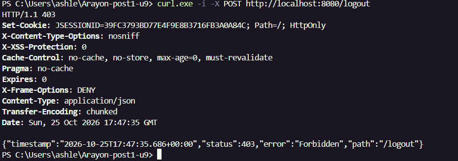
POST a `/logout` sin token: 403.

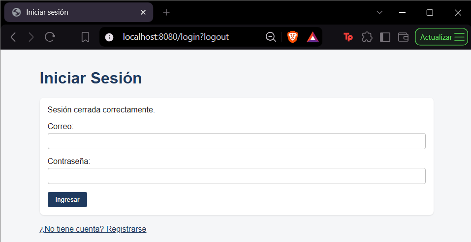
Con el botón del dashboard (token incluido por Thymeleaf): redirige a `/login?logout`.

## Parte 2: API REST stateless protegida con JWT

`apiFilterChain` (`@Order(1)`, `securityMatcher("/api/**")`) es stateless
(`SessionCreationPolicy.STATELESS`), con CSRF desactivado **solo en esta cadena** porque no
usa cookies. `JwtUtil` firma y valida el token (HMAC, expira en 1 hora); `JwtAuthFilter`
(`OncePerRequestFilter`) lo valida en cada petición y puebla el `SecurityContext` sin
consultar la base de datos.

### Login y petición aceptada
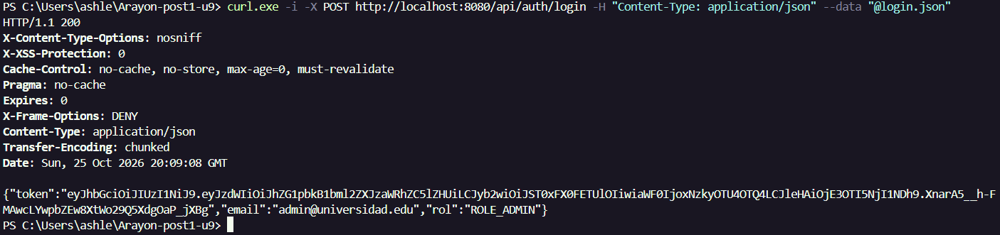
`POST /api/auth/login` con credenciales válidas devuelve 200 y el token.

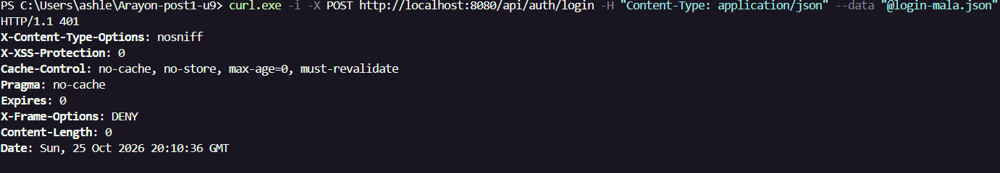
Con contraseña incorrecta: 401, sin token.

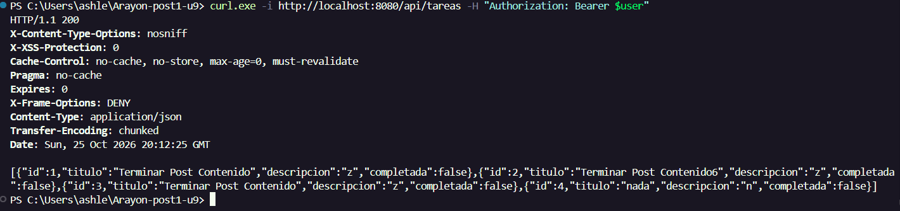
`GET /api/tareas` con `Authorization: Bearer`: 200 y JSON (DTO sin hash de contraseña).

### Rechazos
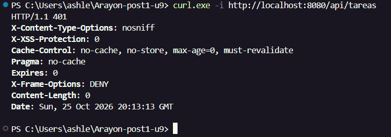
Sin token: 401.

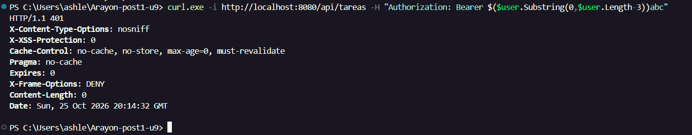
Firma modificada: 401.

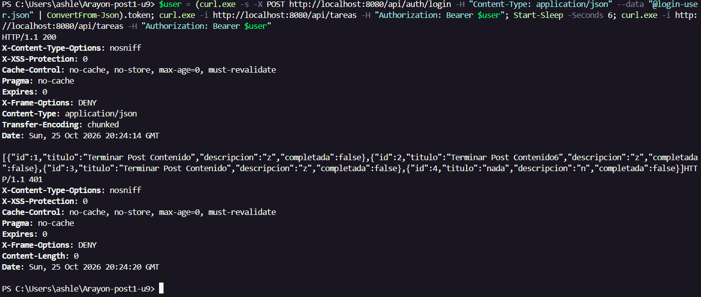
Con `jwt.expiracion-ms=5000`: primero 200 y, pasados 6 segundos, 401.

Token USER en `/api/admin/usuarios`: 403; token ADMIN: 200.

### Coexistencia sesión + JWT
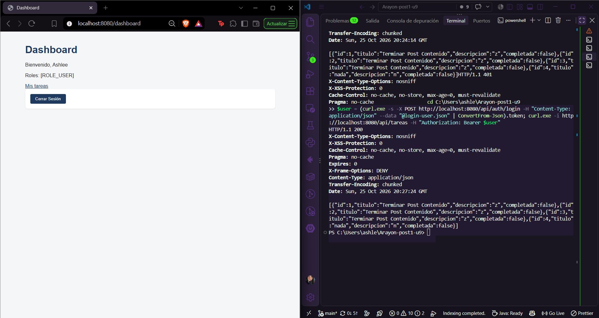
El dashboard (cookie de sesión) y la API (Bearer token) responden a la vez, sin interferirse.

## Por qué dos mecanismos en el mismo proyecto
Las vistas Thymeleaf sirven a un navegador con cookie de sesión: CSRF debe seguir activo.
La API sirve a clientes sin cookies (app móvil, SPA, servicios de terceros): un token
autocontenido en el header resuelve ese caso sin estado en el servidor. Ninguno reemplaza
al otro; cada uno cubre un tipo de cliente distinto del mismo sistema.

## Decisiones propias

Ajustes respecto al material base, con su motivo:

**Versión y configuración**
- Se fijó **Spring Boot 3.3.5**: start.spring.io generó 4.1.2 (Spring Security 7), cuya API difiere del código de la guía.
- Credenciales fuera del código: la contraseña de BD va en la variable de entorno `DB_PASSWORD` y la clave JWT en `JWT_SECRET` (el valor por defecto es solo para laboratorio).

**Seguridad web**
- El dashboard muestra el **nombre** y no el correo, para que la prueba de XSS tenga un campo que admita el payload.
- El usuario se identifica por **email** (`findByPropietarioEmail`): el principal de Spring Security no expone `id`, por lo que la expresión con `principal.id` fallaría.
- `buscarPorTituloDe` filtra por propietario: un USER no ve tareas ajenas al buscar.
- Se agregó el buscador de tareas (`TareaController` y vista), necesario para la prueba de SQL Injection.
- **Mass assignment** evitado: `registrar` fija rol y `activo` en el servidor, y `@InitBinder` limita los campos de `Tarea` a `titulo` y `descripcion`.
- Validaciones adicionales: `@NotBlank` en contraseña y `@Size` en tareas.
- Bean `AuthenticationManager` (requerido por el login JWT) y `/error` en `permitAll`.
- Hoja de estilos mínima enlazada en todas las vistas.

**API JWT**
- `JwtAuthFilter` sin `@Component` e instanciado dentro de `apiFilterChain`, para que no se registre también como filtro global.
- `HttpStatusEntryPoint(UNAUTHORIZED)`: sin él, la API respondería 403 en lugar de 401.
- Login JWT captura `AuthenticationException` y responde 401.
- DTO (`TareaDto`, `UsuarioDto`): evitan serializar el hash de contraseña.
- `ApiAdminController` (`/api/admin/usuarios`) para probar el 403 por rol.

## Casos límite probados
| Caso | Resultado |
|---|---|
| Correo ya registrado | Error en el campo correo 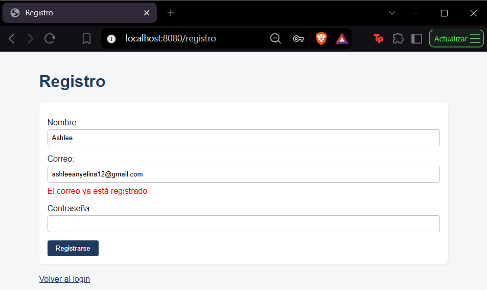 |
| Correo inválido | "Debe ser un correo válido" 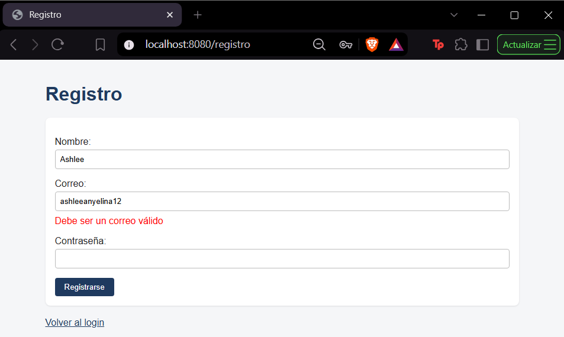 |
| Nombre vacío | "El nombre es obligatorio" 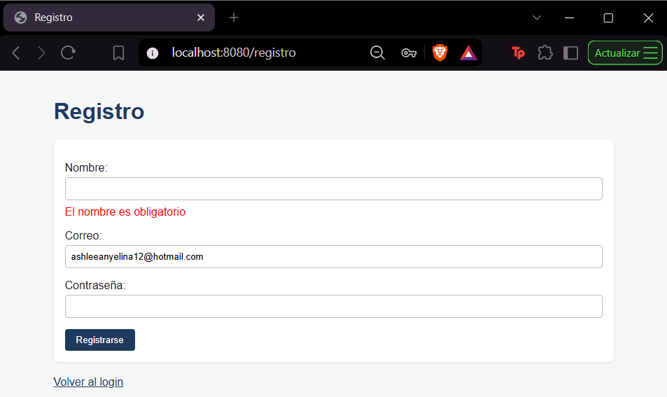 |
| Credenciales incorrectas | Mensaje de error en el login 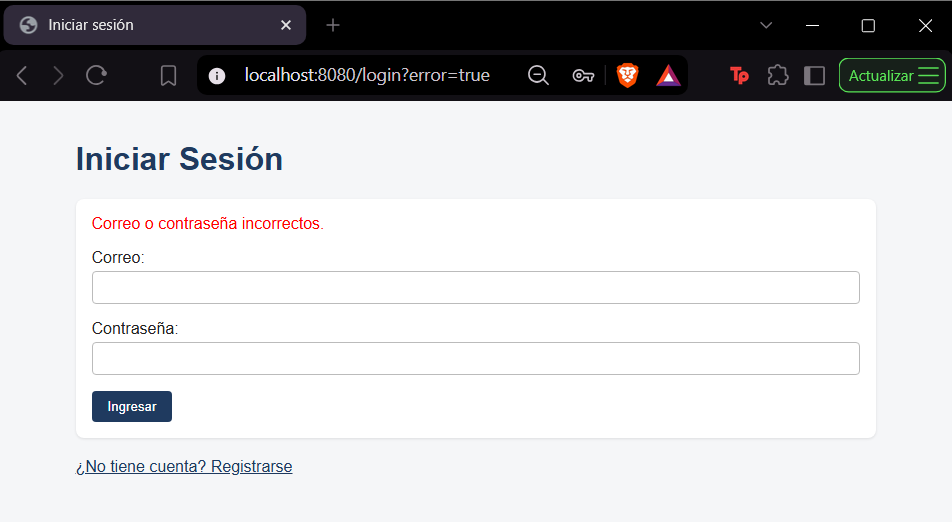 |
| Buscar `%` | Devuelve solo las tareas propias (comodín de LIKE, no es inyección) 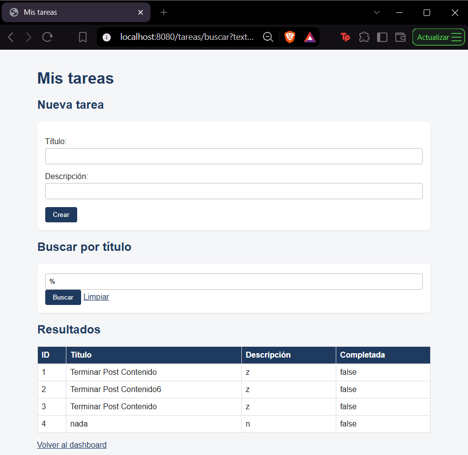 |
| POST a `/tareas` sin token CSRF | 403 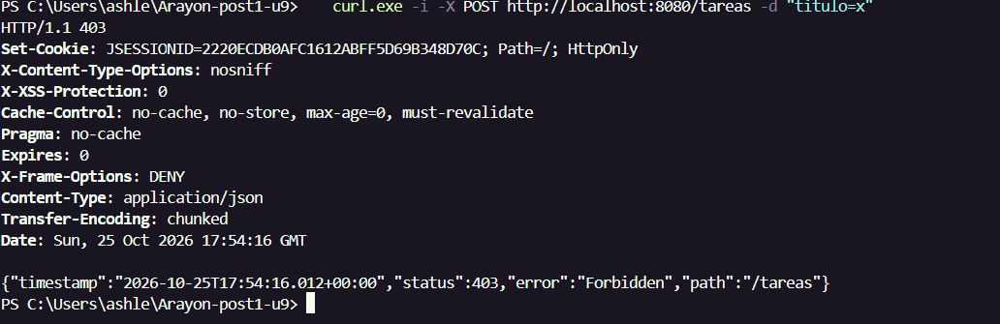 |
| Usuario con `activo=0` | Login rechazado |
| Tabla `tareas` de la Unidad 8 en la misma BD | El INSERT fallaba (error 1364, columna `codigo`). `ddl-auto=update` no elimina columnas: se borró la tabla y Hibernate la recreó. Lección: una BD por laboratorio |

## Nota de seguridad para producción
El valor por defecto de `jwt.secret` es solo para el laboratorio. En producción debe venir
de la variable de entorno `JWT_SECRET` o de un gestor de secretos: quien conozca la clave
puede firmar tokens válidos.

## Cómo compilar y ejecutar
1. Clonar el repositorio.
2. Crear la base `seguridad_db` en MySQL y el usuario `appuser`.
3. Definir `DB_PASSWORD` como variable de entorno.
4. Insertar un usuario `ROLE_ADMIN` con hash BCrypt (generado con `BCryptPasswordEncoder(12)`).
5. `cd seguridad-web` y `./mvnw spring-boot:run`.
6. Vistas web: http://localhost:8080/login
7. API: `POST http://localhost:8080/api/auth/login` (body JSON con `email` y `contrasenia`).